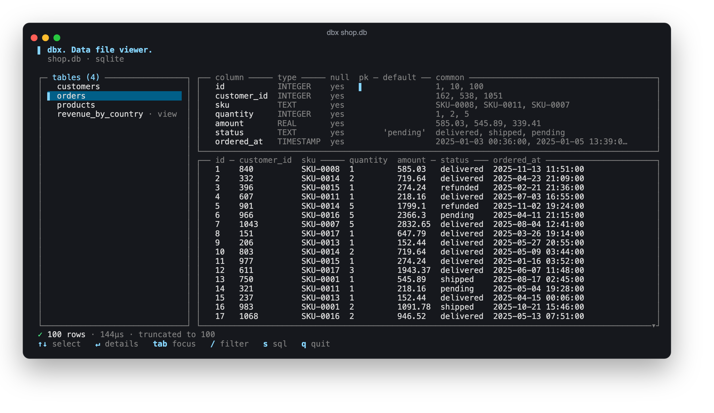
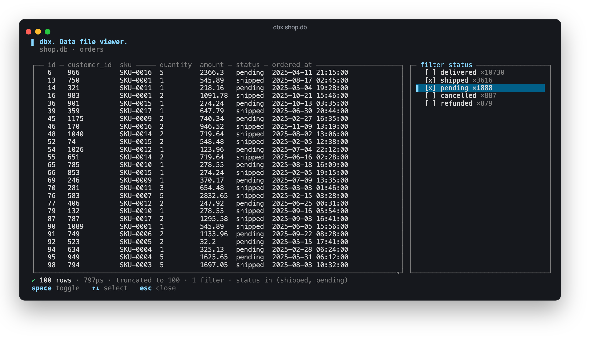
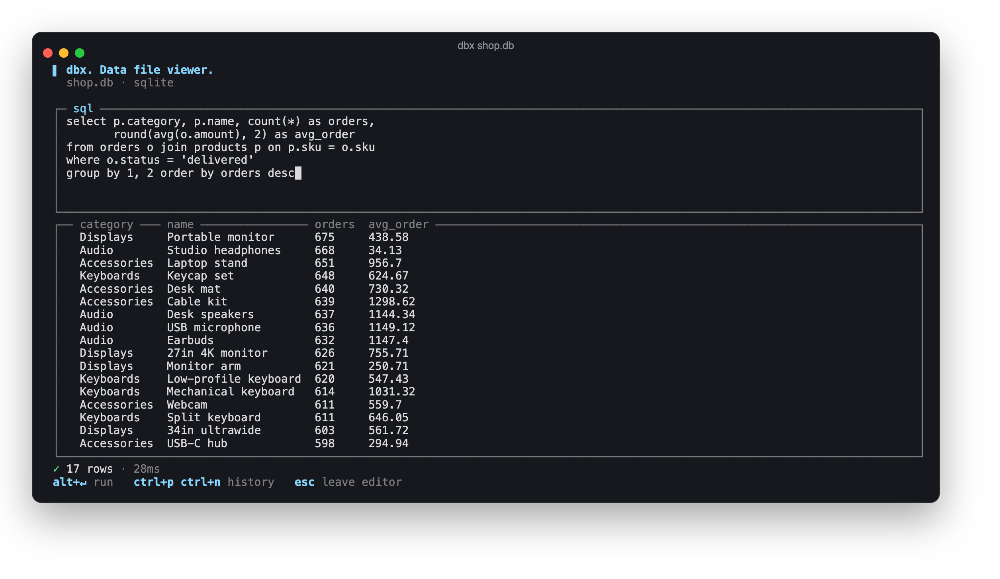

# dbx

A single-binary terminal UI for exploring SQLite, DuckDB, Parquet, CSV/TSV
and JSON files, plus directories and globs of them.



## Install

On macOS (Apple silicon or Intel):

```
curl -fsSL https://raw.githubusercontent.com/G2H/dbx/main/install.sh | sh
```

The script downloads the latest release for your architecture, verifies its
SHA-256 checksum and installs the binary to `~/.local/bin/dbx`. Set
`DBX_INSTALL_DIR` to install elsewhere, or `DBX_VERSION=v0.1.0` to pin a
release. Other platforms: build from source (see [Build](#build)).

## Usage

```
dbx path/to/data.db
dbx path/to/warehouse.duckdb
dbx path/to/events.parquet
dbx path/to/people.csv           # also .tsv, .csv.gz, .csv.zst
dbx path/to/log.ndjson           # also .json, .jsonl
dbx path/to/exports/             # every data file inside, one view each
dbx 'path/to/parts/*.parquet'    # glob, unioned into one view
```

dbx opens everything read-only and detects the type from the file content
(SQLite magic header, DuckDB magic at byte offset 8, Parquet's PAR1
prefix), falling back to the extension. Flat files (Parquet, CSV/TSV with
auto-detected delimiters and types, JSON in records or line-delimited
form, optionally gz/zst-compressed) are served through an in-memory DuckDB
as views named after the files, so filtering, sorting and the SQL view all
work on them. A directory opens every recognizable data file directly
inside it, one view per file. DuckDB databases with named schemas list
every table as `schema.name`.

## Views

- **Tables** (default): the list of tables and views on the left (`/`
  fuzzy-filters it), the selected table's schema (including each column's
  most common values, from a 10k-row random sample on DuckDB-backed files,
  or the first 10k rows on SQLite) and a preview of its first 100 rows on
  the right. `Enter` opens the table in the details
  view.
- **Table details**: a full-screen scrollable grid of the first 100 rows.
  `c` opens a column show/hide panel (`space` toggles one, `a` toggles
  all). Filtering, three ways, all combining with AND:
  - `f` opens a value picker for the highlighted column: its most common
    values with counts; `space` multi-selects them into an `IN` filter.
  - `/` types an expression for the highlighted column: plain text becomes
    a case-insensitive contains match; inputs starting with `=`, `!=`,
    `>`, `>=`, `<`, `<=`, or the words `null` / `not null` become the
    matching WHERE clause.
  - `w` takes a raw SQL fragment (e.g. `age % 2 = 0 and name like 'A%'`)
    appended to the WHERE clause as written.
  `F` lists active filters (`Enter` edits, `x` removes one), `ctrl+r`
  clears all after confirming. `o` sorts rows by the highlighted column
  (press again for descending, a third time to clear).

  
- **SQL**: a multi-line editor on top, results below. `alt+enter`, `F5`,
  or `ctrl+r` executes. Errors show inline; the connection is read-only,
  so writes fail with the engine's own error. `ctrl+p` / `ctrl+n` walk
  the in-session history.

  

`s` flips to the SQL editor from any table screen; `t` flips back to
wherever you were (leave the editor with `esc` first). Everywhere: `tab`
cycles focus, arrows or `j`/`k` move, `PgUp`/`PgDn` jump 10, `esc` goes
back (or leaves an input, or cancels a running query), `q` quits after a
`(y/n)` confirmation, `ctrl+c` quits immediately. Every result is capped
at the first 100 rows; a truncation notice appears in the status line.
NULLs render as a dim `∅`.

Note: `ctrl+enter` stays bound for terminals that report it, but most
(including ghostty) cannot deliver it to this TUI toolkit; use
`alt+enter` or `F5`.

## Build

Native builds are trivial:

```
make build      # or: go build ./cmd/dbx
make test
make lint
```

Go 1.22+ and a C compiler are required: the DuckDB driver
(`github.com/duckdb/duckdb-go/v2`, bundling DuckDB 1.5.4) uses cgo and ships a prebuilt
static libduckdb, so the result is still one self-contained binary with no
runtime shared-library dependency beyond the system libc. The SQLite driver
(`modernc.org/sqlite`) is pure Go.

**Cross-compiling caveat:** because of cgo, cross-compiling needs a C
toolchain that targets the destination platform (for example
`CC="zig cc -target x86_64-linux-gnu" GOOS=linux GOARCH=amd64 go build ./cmd/dbx`).
`make build` targets the host platform only. The exception is `make release`,
which builds both macOS architectures from a Mac (Apple's clang targets either
one) into `dist/`:

```
git tag v0.1.0 && git push --tags
make release VERSION=0.1.0
gh release create v0.1.0 dist/*
```

## Testing

`make test` runs unit tests (file-type detection, identifier quoting, the
filter-to-WHERE builder, limited row scanning, grid rendering) and
integration tests that create throwaway SQLite and DuckDB databases and
exercise both engines, plus a headless UI test that drives the bubbletea
model through the main flows. It also runs `scripts/install_test.sh`,
which exercises `install.sh` against a fake local release (happy path,
checksum mismatch, missing asset).

`testdata/` holds locally generated sample databases for manual poking;
it is not checked in.
